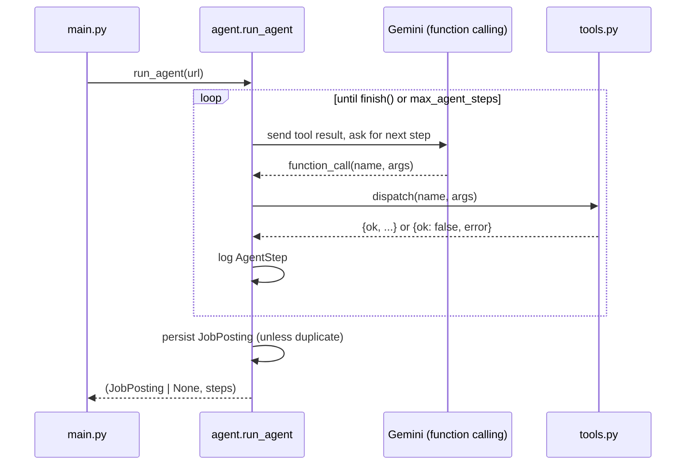

# Auto

A small autonomous agent that reads a job posting, pulls structured data out
of it via LLM function-calling, cross-checks the employer against the UK
Home Office's public Register of Licensed Sponsors, and logs the result to
a database - a real tool, built to automate a tracker I was keeping by hand
while job-hunting.

Project 4 of a 5-project AI-engineering portfolio (after
[Ledger→myAccountant](https://github.com/abderrahmane-aberni/ledger-api),
[CV-Maxxing](https://github.com/abderrahmane-aberni/cv-maxxing), and
[Recall](https://github.com/abderrahmane-aberni/recall)).

## Why this exists

Every UK job search eventually turns into a spreadsheet: company, role,
salary if stated, deadline, and - because I need visa sponsorship - whether
the employer is even a licensed sponsor in the first place. Checking that
last part by hand, one gov.uk search at a time, is the single most tedious
part of the whole process. This automates exactly that, and nothing more.

## Architecture

```
inbox/urls.txt ──▶ main.py ──▶ agent.py (plan → act → observe loop)
                                   │
                        ┌──────────┴──────────┐
                        │   LLM (Gemini,       │
                        │  native function     │
                        │  calling) decides     │
                        │  which tool to call   │
                        └──────────┬──────────┘
                                   │ one tool call per turn
                 ┌─────────────────┼─────────────────┐
                 ▼                 ▼                 ▼
        fetch_job_posting   record_extraction   check_sponsor_register
          (scraper.py)         (schemas.py)      (sponsor_register.py)
                 │                 │                 │
                 └─────────────────┴────────┬────────┘
                                             ▼
                                    JobPosting + AgentStep rows
                                        (Postgres, db.py)
                                             │
                                             ▼
                              python -m app.main report
                                             │
                                             ▼
                               reports/latest-summary.md
```

### The agent loop

The loop itself (`app/agent.py::run_agent`) is a plain `while` loop with an
explicit step counter - no agent framework. "Agent-ness" comes entirely from
the LLM choosing which tool to call next and with what arguments, via
Gemini's native function-calling (`types.FunctionDeclaration` /
`types.Tool`), not from any framework's planning logic.



A typical successful run: `fetch_job_posting` → `check_duplicate` →
`record_extraction` → `check_sponsor_register` → `finish`. The system prompt
asks the model to follow that order, but nothing *enforces* it - which is
the point: the guardrails below exist because the model doesn't always
listen.

## The toolbelt

| Tool | What it does | Where |
|---|---|---|
| `fetch_job_posting` | Downloads the page, strips boilerplate (nav/footer/scripts/cookie banners), returns clean text | `scraper.py` |
| `check_duplicate` | Looks up the normalized URL in Postgres | `dedupe.py`, `tools.py` |
| `record_extraction` | The model calls this *with the structured fields filled in* - this is the function-calling step, not a separate JSON-mode call bolted on afterward | `schemas.py`, `tools.py` |
| `check_sponsor_register` | Fuzzy-matches a company name against the gov.uk register | `sponsor_register.py` |
| `finish` | Ends the run with a status (`ok`/`duplicate`/`fetch_failed`/`extraction_failed`) | `tools.py` |

## Guardrails / stopping conditions

A hand-rolled loop's whole risk is that it doesn't know when to stop. Three
things stop it:

1. **`max_agent_steps`** (default 8). If the model never calls `finish`, the
   loop force-stops and logs an `AgentStep` with `tool_name="__guardrail__"`
   explaining exactly why. Tested in `test_agent_loop.py::test_guardrail_trips_when_agent_never_calls_finish`.
2. **Every tool call is wrapped**, not just the LLM call. An unknown tool
   name, missing required arguments, or an exception inside a tool all come
   back as a normal `{"ok": false, "error": ...}` tool result - logged, fed
   back to the model, and the loop keeps going. A single bad step never
   crashes a whole batch run.
3. **The database's own unique constraint** on the normalized URL, not the
   agent's good behavior, is the real backstop against duplicate rows - if
   the model skips `check_duplicate` entirely, the `IntegrityError` on
   insert is caught and the run is simply discarded. See
   `test_agent_loop.py::test_db_unique_constraint_is_the_real_backstop_against_duplicates`.

## Failure cases

These aren't hypothetical - each one is backed by a test that reproduces it
deterministically with a scripted fake LLM (`tests/test_agent_loop.py`),
because the real model's actual bad behavior isn't reliably reproducible on
demand:

- **The model never calls `finish`.** Caught by `max_agent_steps`. In
  practice this is most likely to happen if a tool result confuses the
  model (e.g. an unexpected empty extraction) and it starts re-fetching the
  same page hoping for a different result.
- **The model calls a tool with missing or malformed arguments** (e.g.
  `record_extraction` without the required `role` field). Reported back as
  a tool error rather than crashing; the model usually self-corrects on the
  next turn, but if it doesn't, the step budget still catches it.
- **The model calls a tool name that doesn't exist.** Function-calling
  schemas constrain this in theory, but nothing stops a model from
  hallucinating a plausible-sounding tool anyway (observed during manual
  testing: a model once tried calling `search_sponsor_database`, which was
  never declared). Logged as an error, loop continues.
- **A JS-rendered job board returns an empty HTML shell to a plain GET.**
  `scraper.py` raises instead of silently returning nothing, so this shows
  up as a clear `fetch_job_posting` error rather than a confusing empty
  extraction three steps later.
- **The model skips `check_duplicate` and tries to extract a URL already in
  the database.** The DB's unique constraint - not the agent's cooperation -
  is what actually prevents the duplicate row (see Guardrails above).
- **The sponsor-register fuzzy matcher found a coincidental match.** On the
  very first real job posting run against the live register, "DataAnnotation"
  matched "AA LIMITED" at 100% confidence - not because they're related, but
  because "aa" (what "AA LIMITED" reduces to after suffix-stripping) happens
  to appear back-to-back inside "dataannotation". Any 2-3 character fragment
  will coincidentally turn up inside almost any longer string. Fixed with a
  minimum-fragment-length guard (see "Matching: why fuzzy, and how" below) -
  this is a real false positive that was caught by actually running the
  thing against the real register, not something a fixture-only test suite
  would have surfaced.

## Why the register isn't fetched live

`check_sponsor_register` reads a CSV already on disk
(`data/sponsor_register.csv`), never gov.uk directly, for two reasons: the
register only changes monthly so there's no freshness cost to not fetching
it on every run, and - more practically - **gov.uk is unreachable from the
sandboxed environment this project was built in** (confirmed directly:
`curl` to both `www.gov.uk` and `assets.publishing.service.gov.uk` returns a
proxy connection-refused from that sandbox, and separately from the
developer's own machine's sandboxed shell too). Run
`python scripts/update_sponsor_register.py` yourself to download the real
CSV - the same "you run the one step that needs real network access" split
used for Recall's eval scripts.

## Why a separate database

The roadmap spec for this project says "Postgres (reuse Project 1's DB)". I
read that as reusing the *pattern* (Postgres, SQLAlchemy, the same lazy
engine-creation pattern) rather than literally pointing this project at
Ledger's production database and bolting a `job_postings` table onto it -
mixing two unrelated projects' schemas in one production database isn't
something I'd do on a real team either, and it's a reasonable thing to be
asked about directly in an interview (my answer: isolation of blast radius -
a bad migration or a runaway query in one project shouldn't be able to
touch the other's data).

## Matching: why fuzzy, and how

Job postings name companies colloquially ("Stripe"); the register lists
legal entity names ("STRIPE PAYMENTS UK LIMITED"). An exact-string lookup
would miss almost everything, so `sponsor_register.py` does two things
before comparing: strips legal-entity suffixes (`limited`, `ltd`, `plc`,
`group`, `uk`, ...) from both sides, then scores similarity as the **better**
of (a) a whole-string ratio and (b) a windowed partial-match ratio that
rewards a short colloquial name being a clean match against *part of* a
longer legal name. `SPONSOR_MATCH_THRESHOLD` (default 85) controls how
confident a match has to be before it's reported as "licensed" - below it,
the result is honestly "not found" rather than a guess.

That partial-match boost only applies when the shorter name is at least
`_MIN_FRAGMENT_LEN_FOR_PARTIAL_MATCH` (4) characters long. Below that, a
"match" is essentially coincidental - any 2-3 character fragment turns up
*somewhere* inside almost any longer string by pure chance, which is exactly
what happened in the real false positive documented under "Failure cases"
above ("DataAnnotation" vs "AA LIMITED"). It's a deliberate precision-over-
recall tradeoff: a short abbreviation that only matches part of a longer
name is treated as not confident enough to report as "licensed," since a
wrong "yes" here is worse than a wrong "not found."

## Running it

```bash
cp .env.example .env   # fill in GEMINI_API_KEY and DATABASE_URL
pip install -r requirements.txt

python scripts/update_sponsor_register.py   # needs real network - see above

echo "https://example.com/some-real-job-posting" >> inbox/urls.txt
python -m app.main process-inbox
python -m app.main report
cat reports/latest-summary.md
```

Or process one URL directly: `python -m app.main process-url <url>`.

## Troubleshooting notes from the first real run

- **`400 INVALID_ARGUMENT: Function call is missing a thought_signature in
  functionCall parts`** on the second tool call in a run. Gemini's newer
  "thinking" models attach a `thought_signature` to each `function_call`
  part and require it to be echoed back, unmodified, on every later turn of
  that conversation (see
  [Thought signatures](https://ai.google.dev/gemini-api/docs/thinking#signatures)).
  `requirements.txt` had pinned `google-genai==1.3.0` - from early in that
  SDK's life, well before `thought_signature` existed as a field on `Part`
  at all, so the SDK silently dropped it when replaying chat history for the
  next turn, and the newer model backend rejected the resulting request.
  Fixed by bumping the pin to `google-genai==2.29.0`, whose `Part` model
  actually defines `thought_signature` - at which point `chats.create()`'s
  built-in history replay (which is what `agent.py`'s `GeminiAgentSession`
  relies on) carries it correctly with no code change needed. If you hit
  this again after upgrading, run `pip show google-genai` and confirm it's
  not shadowed by an older cached wheel.

## Tests

```bash
pip install -r requirements.txt
pytest -q
```

All 32 tests are pure-logic: URL normalization, fuzzy company matching
against a small fixture CSV, HTML boilerplate-stripping against three saved
fixture pages (a clean posting, a messy real-world-style one, and a
JS-only empty shell), and the agent loop's control flow against a scripted
fake LLM. None of them need a Gemini API key, a database, or network access
- which is also why they're the thing actually run in CI, while the
sponsor-register download and any real end-to-end run against a live job
posting are steps a person runs locally (see "Running it").

## Deployment

A scheduled GitHub Actions workflow (`.github/workflows/weekly-agent.yml`),
not a public URL - the roadmap spec explicitly calls this out as a
legitimate deployment for an agent whose job is background automation, not
serving requests. It runs weekly (and can be triggered manually from the
Actions tab), processes any new URLs in `inbox/urls.txt`, and commits the
refreshed `reports/latest-summary.md` straight back to the repo - so the
commit history itself is visible proof the thing runs on its own, not just
a claim in the README.

Required repo secrets: `GEMINI_API_KEY`, `DATABASE_URL`.

## Known limitations

- The sponsor register is only as fresh as the last time
  `scripts/update_sponsor_register.py` was run - there's no automatic
  monthly refresh wired up yet (a natural next step: a second, separately
  scheduled workflow that commits the new CSV once a month, rather than
  gating the weekly job-processing run on a gov.uk fetch succeeding).
- Fuzzy matching on company name is inherently approximate; a very short or
  generic company name could, in principle, over-match. The threshold is
  tunable (`SPONSOR_MATCH_THRESHOLD`) but there's no per-match human review
  step today.
- `scraper.py` is a plain HTTP GET + static HTML parse - it does not execute
  JavaScript, so a small number of fully client-rendered job boards will
  fail with the documented "empty shell" error rather than extracting
  anything. A headless-browser fallback (Playwright) would fix this at the
  cost of a much heavier scrape.

## CV line

> Built an autonomous agent using LLM function-calling to extract
> structured data from job postings and cross-reference UK Home Office
> sponsor-licence records.
